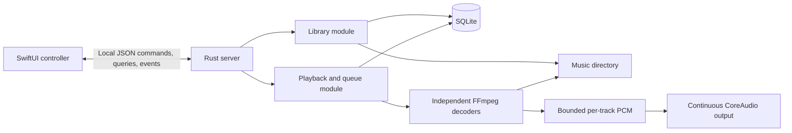

# Initial spike: Rust player server + SwiftUI controller

**Execution status:** the original GStreamer `playbin3`/global-ReplayGain pipeline
failed the audio gate and was replaced by independent FFmpeg decoding feeding a
continuous CoreAudio stream. The native engine, persistent local server,
durable library, and native SwiftUI controller are implemented and exercised;
see [SPIKE_RESULTS.md](SPIKE_RESULTS.md) for commands, evidence, and limitations.
Development LaunchAgent/bootstrap and the 50,000-track/10,000-entry scale experiments are also exercised; results distinguish build profiles, process-cold startup, warm startup, and actual native filtering.
Playback controls include server-owned Next/Previous and toggle, occurrence-bound native seeking, page-independent Now Playing metadata, and macOS system controls. Regular playlists have durable identities/order, bounded native browsing/editing, and atomic enqueue/play. Native multi-row dragging supports insertion points and spring-loaded navigation. Structured live library/playlist filters support title/artist/album predicates, symbolic Boolean operators, grouping and value lists. Smart playlists persist these rules, refresh live membership, and atomically capture full results into the queue or a new regular playlist; dynamic queue autofill remains separate. Server-owned artwork discovery/caching and native album/Now Playing images are implemented and exercised through rescan, browser navigation and offline relaunch. The client remains running after closing its window; explicit Quit pauses daemon audio (resumed on the next launch) and removes its system controls; see `docs/superpowers/specs/2026-10-20-quit-pause-and-player-bar-design.md`. Protocol v8 requires matching client/server processes; the main database remains schema 4.

## Development commands

Install Rust, Xcode command-line tools, Python 3.9+, and optionally `just`
(`brew install just`). Debug builds also need Homebrew FFmpeg and pkg-config
(`brew install ffmpeg pkg-config`). Release builds compile pinned FFmpeg from
source and do not require Homebrew FFmpeg or pkg-config.

| Command | Action |
| --- | --- |
| `just` | List available recipes. |
| `just build-server` | Build the Rust server and companion CLI tools (debug). |
| `just build-server-release` | Build release Rust binaries against pinned, source-built FFmpeg. |
| `just test-server` | Run all Rust unit and integration tests; hardware tests remain opt-in. |
| `just build-client` | Build the SwiftUI client (debug). |
| `just build-client-release` | Build the SwiftUI client with release optimizations. |
| `just test-client` | Run the Swift client test suite. |
| `just build` | Build both components (debug). |
| `just build-release` | Build both components with release optimizations. |
| `just test` | Test both components. |
| `just dmg` | Build a self-contained release app and package `target/Tyranny.dmg`. |

Debug Cargo builds use `target/debug` unless overridden by `CARGO_TARGET_DIR`.
Release recipes isolate their Rust artifacts in `target/portable-rust/release`
so development headers/libraries cannot be reused accidentally. Swift uses
`target/swift-client/debug` and `target/swift-client/release`.
The build recipes do not replace `target/Tyranny.app`. Unbundled release Rust
binaries still reference the pinned build cache; use the app/DMG for relocation.

To package the development app, stop the app/daemon before running
`scripts/build_macos.sh`; by default it bundles a Homebrew-linked release server
with a debug client. `scripts/build_macos.sh release` instead builds both
components in release mode and assembles a self-contained
`target/release/Tyranny.app`. An optional second argument selects the app destination.

### Release disk image

Run `just dmg` or `scripts/build_dmg.sh` to build the release client and server,
assemble and ad-hoc sign a fresh app bundle, and create a compressed
`target/Tyranny.dmg`. The image contains `Tyranny.app` (including its server,
FFmpeg libraries, icon, and source/license artifacts) and an Applications
shortcut. Drag the app to Applications before launching it; do not run the
managed server from the mounted image.

The source builder currently supports native **arm64 macOS**, with a deployment
target of macOS 14. It downloads [FFmpeg 9.0.2](https://ffmpeg.org/releases/ffmpeg-9.0.2.tar.gz)
and verifies the pinned SHA256 before extraction. The pin was established by
verifying the upstream detached signature against FFmpeg's published signing
fingerprint. The first build needs network access; subsequent builds reuse a
checksum-verified cache under `target/native`, keyed by source, configuration,
architecture, builder, compiler, and SDK. Interrupted installs are not reused.
FFmpeg's build system requires a checkout/toolchain path without whitespace or
shell/make metacharacters; the builder rejects these paths early. The packaged
app itself supports spaces and Unicode in its installation path.

The controlled configuration retains native decoders/demuxers and embedded image
support, builds shared avcodec/avformat/avutil/swresample, and disables GPL,
nonfree, version-3-only code, external-library autodetection, encoders, muxers,
devices, filters, hardware acceleration, and networking. It uses macOS system
zlib, bzlib, and iconv. This preserves the current local-file playback path;
it does not add the external decoder engines or streaming features in the requirements.

Packaging copies the four dylibs to `Contents/Frameworks`, rewrites their
transitive dependencies and install IDs to `@loader_path`, and removes runpaths.
Unresolved libraries, non-system dependencies outside the pinned prefix,
unapproved libraries, symlink escapes, and basename collisions fail packaging.
`Contents/Resources/native-dependencies.json` records the closed, bundle-relative
dependency graph. Libraries are signed after relocation, followed by the helper
and app. Temporary staging leaves the development app untouched; an existing
DMG is replaced only after the new image passes checksum verification.

This software uses libraries from the FFmpeg project under LGPL-2.1-or-later.
`Contents/Resources/FFmpeg` includes the exact source archive, license texts,
configuration headers, and `build-info.json` with source checksum, configure
arguments, and toolchain provenance. The standard About panel's `Credits.rtf`
points to those resources. Keep these artifacts when distributing the app and
include FFmpeg attribution/source access on any download page; see
[FFmpeg's compliance checklist](https://ffmpeg.org/legal.html).
Dynamic linking and source inclusion are not a blanket codec-patent or legal clearance.

The DMG no longer needs Homebrew at runtime. It is still **ad-hoc signed, not
Developer ID signed or notarized**, and is not a universal binary. Gatekeeper
may block downloaded copies.

Verification on 2026-10-20:

- `just dmg`: built the source libraries, release binaries, and verified DMG;
  a second source-builder invocation reused the verified cache.
- `python3 -m unittest discover -s scripts -p test_macos_dependencies.py`:
  six real Mach-O fixture tests passed, including transitive relocation after
  removing the source libraries and rejection of invalid dependency graphs.
- Rust tests against the pinned prefix (`FFMPEG_DIR=<prefix>
  MACOSX_DEPLOYMENT_TARGET=14.0 cargo test --locked --release --all-targets
  --target-dir target/portable-rust`): 223 passed; one hardware test ignored.
- Copied the signed app out of the mounted DMG to a path containing spaces and
  Unicode, then unmounted the image. With sandbox reads denied for `/opt/homebrew`,
  `/usr/local`, and the entire repository, the helper imported 12 fixtures and
  preserved Unicode metadata. FLAC, MP3, Vorbis, Opus, AAC, ALAC, WavPack, and WMA
  playback passed; two FLAC tracks produced exactly 48,000 stereo frames with
  bit-exact samples and no gap, overlap, or underruns. ReplayGain and paused
  seeking passed.
- The relocated release client rendered the imported library and connected over
  protocol v9 under the same sandbox. The RTF attribution parsed successfully;
  opening About automatically was blocked by Apple Events permissions.
- Local evidence: `target/portable-release-verification/report.json` and
  `release-client.png`. This was a sandboxed same-host check, **not** a clean-Mac,
  macOS 14, notarization, or acoustic-output test.

## Goal and scope

Prove one complete local workflow: launch the app, choose a music directory, see scan progress, browse an artist/album/track library, queue music, and hear continuous playback. Close and reopen the client without interrupting playback or losing authoritative state.

This is a macOS-first architectural spike, not a commitment to drop anything in [REQUIREMENTS.md](REQUIREMENTS.md). The full format/output/provider lists remain product requirements; the spike proves a representative subset and records unsupported capabilities explicitly.

**Deployment decision:** the server reads files and plays through the audio device on the server's machine. Initially both processes run on the same Mac, as the same user. A future remote controller would still control those speakers; streaming audio to the controller is a different feature. Follow MPD's ownership model, not necessarily its wire protocol.

## What the reference implementations teach us

Five parallel read-only scans covered all sibling reference repositories. These are implementation observations, not runtime validation of those apps.

| Reference | Evidence and lesson | Decision for tyranny |
| --- | --- | --- |
| MPD | Server partitions own queue/player/outputs; queue entries have their own IDs and change versions. `idle` signals changes rather than providing durable event replay. [Partition](../mpd/src/Partition.hxx), [queue IDs](../mpd/src/queue/Queue.hxx#L37-L74), [idle](../mpd/src/client/Idle.cxx) | Server authority; stable queue-entry IDs; explicit reconnect snapshots. Do not reproduce partitions, plugin infrastructure, or MPD compatibility in the spike. |
| Resonance | Rust wraps GStreamer `playbin3`; its EOS handler stops playback before notifying the queue. Import embeds Python and Mutagen; models depend on GTK/GLib. [backend](../resonance/src/player/gst_backend.rs#L53-L110), [EOS](../resonance/src/player/gst_backend.rs#L332-L335), [importer](../resonance/src/importer.rs) | Rust/GStreamer is a concrete starting point, but this implementation is not evidence of gapless playback. Keep plain Rust models; do not inherit GTK or embedded Python. |
| Strawberry | Non-crossfade playback prepares the next URL on the existing pipeline. Album queries distinguish album artist from track artist; CUE identity includes URL, segment start, and sheet. [preload](../strawberry/src/engine/gstengine.cpp#L193-L209), [album query](../strawberry/src/collection/collectionbackend.cpp#L1100-L1108), [CUE index](../strawberry/data/schema/schema-29.sql#L3) | Test transitions before building the UI. Separate file, track, and queue-entry identity. Preserve compilation metadata from the first import. |
| cmus | Queue entries can be appended/prepended independently; playback has buffering and gain logic separate from presentation. Filters and cursor search are distinct. [queue](../cmus/play_queue.c#L41-L67), [player](../cmus/player.c), [filters](../cmus/filters.c), [search](../cmus/search.c) | Separate queue from saved playlists. Use explicit commands that future buttons, keybindings, and command mode can share. Do not import the command-language grammar yet. |
| Feishin | Ordinary MPV playback is client-side; Jukebox is a separate server-playback path. Large lists use paged caches keyed by server/query. [MPV engine](../feishin/src/renderer/features/player/audio-player/engine/mpv-player-engine.tsx), [Jukebox engine](../feishin/src/renderer/features/player/audio-player/engine/jukebox-player-engine.tsx), [list loader](../feishin/src/renderer/components/item-list/helpers/item-list-infinite-loader.ts#L37-L100) | Borrow bounded loading, not renderer-owned playback state or multiple-engine reconciliation. SwiftUI must not maintain a second authoritative queue. |

Use these repositories as design references, not source to transplant. They contain GPL-licensed code; review licensing before any reuse, and separately review the selected multimedia binaries/plugins before distribution.

## Proposed architecture

Keep one Rust package with internal modules initially, plus a separate native macOS app target. No microservices, public plugin system, shared database access, or speculative backend traits.

- **Library module:** owns roots, asynchronous indexing, metadata, album grouping, bounded queries, and scan progress. SQLite with migrations, transactional batches, and indexes; no full import on startup.
- **Playback module:** owns queue order, current entry, transport state, next-item preparation, gain, and resume policy. Serialize commands through one owner. Native decoding and filesystem access stay on that worker; the continuous output callback consumes only preallocated PCM. SwiftUI, database work, and network requests must not block the audio callback.
- **Artwork module:** two bounded workers own embedded/folder discovery, release-ID-only Cover Art Archive retrieval, image normalization and a disposable persistent cache. Separate artwork connections prevent slow image requests from queuing ahead of main transport controls.
- **Protocol module:** exposes commands, queries, and authoritative state without leaking FFmpeg types or SQLite rows. The implemented server uses Tokio Unix streams, Serde, and rusqlite; the audio engine uses ffmpeg-next, a native CoreAudio DefaultOutput AudioUnit, and bounded SPSC rings.
- **SwiftUI client:** owns navigation, selection, view caches, and connection presentation. Uses native tables/split views and a folder picker. Does not decode audio, scan the directory, or decide which track plays next.

### Small initial interface

Use versioned UTF-8 JSON over filesystem Unix-domain stream sockets, accessible from Swift through Network.framework `NWConnection`. Each message has a four-byte unsigned big-endian byte-length prefix; reject empty messages and lengths above 16 KiB for requests or 8 MiB for replies before allocating payload storage. Preserve partial frames across asynchronous reads. Use request IDs for replies and typed events. The native client keeps its main control connection separate from two reusable artwork connections; no HTTP/WebSocket, MPD compatibility layer, or Rust/Swift FFI.

- Library: add root, request rescan, observe scan status, and list album artists/albums/tracks with one shared structured track filter and bounded pages.
- Artwork: request a bounded thumbnail/display image for an authoritative album or durable queue occurrence at a library revision. The client cannot supply an image path or provider URL.
- Saved playlists: create, rename, delete, insert indexed tracks before an occurrence or at the end, atomically remove/reorder occurrence batches, read bounded pages, and append a whole playlist to the queue with optional immediate playback. The library's Add to Playlist picker can create and populate a new destination directly. Playlist editing never edits already-enqueued occurrences.
- Smart playlists: save/edit a named library filter, preview and browse bounded live results, and atomically create a regular snapshot of every matching track. Rules evaluate over the entire available library, independently of selected artist/album panes and temporary entry filters. The Add to Playlist picker lists regular destinations only.
- Queue: append, atomically insert indexed track batches or move occurrence batches, remove, clear, and read a page. Commands address queue-entry IDs, not row indexes or track IDs. Native dragging captures source IDs/revisions; cross-page drops use revision-bound insertion anchors.
- Transport: play a queue entry, pause, stop, next, previous, seek, volume, and ReplayGain mode.
- State: current entry, actual transport state, position/duration, queue/library/playlist revisions, scan state, and actionable errors.

At connection, send a protocol version, a fresh server-instance ID, and an authoritative control-state snapshot, followed by ordered events. Capture snapshot and event subscription in the same serialized operation so changes cannot fall between them. Queue/library/playlist pages carry revisions; reject stale mutations and restart stale page reads rather than merge inconsistent data. Reconnect always refreshes state; no durable event log in the spike. Do not automatically replay a non-idempotent command after an uncertain disconnect.

Position updates are low-rate observations; the UI may interpolate between them using a local monotonic clock, then correct on seek/pause/track change. A successful command receipt is not proof audio has started: engine events determine actual playback state.

Listen only at `<state-dir>/control.sock`: a socket owned by the current user with mode `0600`, inside an owned `0700` directory. Validate canonical ancestors against foreign ownership and unsafe write permissions, allowing root-owned sticky temporary directories. Rust verifies same-effective-UID peers; the native client validates the private directory and socket because Network.framework does not expose peer credentials. Hold the state-directory lock while checking/removing an owned stale socket and through owner shutdown and inode-checked socket cleanup. Refuse live listeners, symlinks, non-sockets, unsafe permissions, and paths exceeding the platform socket-address byte limit. No bearer tokens, TCP listeners, or network fallback. Existing token files are inert and left untouched.

### Identity and persistence invariants

- A **media asset** locates a file; a **track** is a playable item, potentially a segment of that file; a **queue entry** is one occurrence of a track. Repeated tracks in a queue have different entry IDs. CUE parsing is deferred, not made impossible by using paths as track IDs.
- Preserve title, track artist, album artist, album title, disc/track numbers, compilation flag, duration, and available gain/peak and MusicBrainz IDs. Store Unicode metadata without destructive normalization; keep filesystem locations separate from display/search strings.
- Group albums by release ID when available; otherwise use album artist/title and source-directory context, not title alone. Compilation tracks keep their individual artists without splitting the album. Sophisticated cross-directory release reconciliation is deferred.
- Queue entries survive removal/reordering of other entries. Removing the current entry stops playback in the spike; removing/moving a prepared next entry must invalidate that preparation. End of queue stops; no implicit fallback to the library.
- Regular playlists have independent stable identities and occurrence IDs, including duplicates. Smart playlists have stable playlist identities and persisted rules; their read-only result IDs are library track IDs, not stored occurrence IDs. Catalog and individual revisions protect edits; entry pages also bind library revision. Names are unique under Unicode lowercase matching. Missing indexed sources remain visible in regular playlists but leave smart membership; loading an unavailable regular playlist fails without a partial queue edit.
- Persist roots, indexed metadata, regular playlist order/occurrences, smart rules, queue order/current entry, settings, and position checkpoints. Acknowledge durable edits after commit. Restore stopped/paused by default; automatic playback is explicit opt-in. Checkpoint position periodically and on pause/clean shutdown; document bounded position loss after a crash.

## Build order and acceptance gates

### 1. Prove the audio path before committing to it

The first candidate used GStreamer `playbin3`, `osxaudiosink`, and global `rgvolume`. It failed trim, transition, gain-fallback, and mixed-rate checks. The rejected measurements were recorded in `spike-results/audio-gate.json` (generated reports are now ignored and have been removed from Git history); that backend is no longer part of the executable. Written findings remain in [SPIKE_RESULTS.md](SPIKE_RESULTS.md).

The replacement uses a fresh native FFmpeg demuxer/decoder/resampler per track, applies gain before buffering, and feeds one CoreAudio DefaultOutput AudioUnit with 48 kHz stereo client PCM. CoreAudio converts to the device's native format without changing its nominal clock; the original CPAL output adapter incorrectly required 48 kHz hardware and has been removed. Queue-occurrence tokens invalidate prepared PCM. The fixture suite covers FLAC, two MP3 encoder variants, libvorbis, Opus, WAV, and AAC-in-MP4; these tested formats do not establish the complete FFmpeg/libmodplug/BASS requirement.

**Gate:** a headless Rust executable plays actual audio, seeks/pauses, advances tracks without the UI, and applies track/album gain correctly. Use adjacent fixtures split from a continuous signal and capture PCM at the output seam to check missing/duplicated frames, including encoder delay/padding in lossy fixtures. Also listen through CoreAudio; an internal PCM capture alone does not prove the device path. Report same-rate gapless results separately from mixed-rate/channel transitions. Exercise a short track, corrupt next track, and queue edit during preparation; an unplayable next entry must produce a visible error, not hang or loop.

Use a fixed output rate with resampling for this first engine; bit-perfect output and automatic hardware-rate switching are not spike claims. If measured transitions or macOS deployment fail, stop and revisit the engine before adding product surface. The executable links FFmpeg directly, not through a decoder subprocess or MPD wrapper. Passing automated captures and device execution still does not replace the listening gate.

### 2. Establish server authority and reconnect behavior

Add the command owner, queue-entry IDs, protocol, and SQLite-backed queue/settings. Drive it with a small development client before SwiftUI.

**Gate:** two connections see the same current entry and queue. Append the same track twice, reorder entries, disconnect one controller, and reconnect it during playback. It receives current state, not stale local history. Restart the server: the queue survives and optional resume follows the chosen policy. A rescan or slow controller must not stall audio. Keep regression coverage for duplicate identity, stale edits, and next-item transition races.

**Executed:** the real server passed two-controller, stale-edit/page, disconnect/reconnect, slow-client, crash-restart, paused-default, and opt-in-resume checks through both clock-paced capture and CoreAudio. Persistent queue/settings and the development controller are implemented. The library gate also exercises import during playback; the complete application workflow is not yet claimed.

### 3. Build folder onboarding and a durable library

Walk one selected directory in a bounded background worker; use native FFmpeg metadata extraction to reuse the selected multimedia runtime. Import in batches, expose discovery/indexing phases and failure counts, and retain usable records when another file is unreadable. Once enumeration is complete, show determinate processed/total progress rather than a fabricated percentage.

Manual rescan is enough initially: compare per-file size/mtime, update changed records, and reconcile missing files only after a successful scan. A temporarily unavailable root must not erase the collection. Do not rely on directory mtime alone to detect edited tags. Full filesystem watching and robust move detection come later.

**Gate:** import a real collection containing Unicode paths, missing tags, a compilation, multiple discs, duplicate album titles, and an unreadable/corrupt file. Reopen the server and browse the index without a rescan. Add/change/remove files and rescan without duplicating unchanged tracks. Metadata-only scale fixtures may exercise queries, but do not substitute them for a real audio import.

**Executed:** the native scanner and dedicated SQLite coordinator import generated real FLAC/WAV files, expose bounded revision-consistent queries, and enqueue indexed tracks through the playback owner. The process gate covers 2,056 imported tracks, metadata/grouping, unchanged and changed rescans, unavailable roots, incomplete traversal, corrupt-file retries, restart without rescan, interrupted-scan recovery, and playback during import. Missing entries become unavailable only after a complete scan; their identities remain durable. Native folder selection is exercised in phase 4; phase 5 separately measures a 50,000-track metadata-only index, not a real 50,000-file import.

### 4. Build the native three-pane controller

Use a concrete first interpretation of the requirements: **album artists | albums | tracks**, with a persistent transport strip and a separate queue view. Add a prominent “Choose Music Folder” empty-state action, scan progress, live text filtering, multi-selection, and enqueue/play actions. Keep native appearance; artwork-provider integration and custom theming are not prerequisites.

Request bounded pages for both library and queue. Preserve selection by ID across refreshes. Build explicit disconnected, connecting, scanning, empty, ready, and error presentations rather than treating an empty list as every state.

**Gate:** complete the choose-folder-to-play workflow through the actual SwiftUI surface. Close and reopen the client while the daemon keeps playing. Seek, pause, enqueue a selection, and change the queue without duplicate commands or stale highlighting. Filtering/browsing must remain responsive while scanning and playing.

**Executed:** the ad-hoc-signed development `Tyranny.app` completes the actual native picker-to-play workflow against the Rust server in clock-paced and CoreAudio modes. Native controls exercise three-pane selection, bounded page replacement, multiselection playback, pause/seek/resume, queue reorder/removal, filtering during an active rescan, persisted resume settings, disconnect/reconnect, and quit/relaunch without interrupting server playback. The fixture grows from 105 to 1,129 real audio paths; the UI keeps 100-row pages. Composited screenshots and separate Swift transport/model regressions are retained with the results. This proves the controller surface, not managed daemon startup, human listening, or production-scale latency.

### 5. Prove the macOS process and scale assumptions

Run the server independently as a per-user process; use a development LaunchAgent to establish its lifetime and an app connection/bootstrap path. Closing a window or quitting the controller must not kill it. Defer a polished installer, not the independent-process proof.

Use an explicitly **non-sandboxed development build** for the spike. The daemon must itself verify access to the selected root and retain access after restart; a folder selected by the GUI is not proof that another process can read it. TCC and ordinary filesystem restrictions still apply. If sandboxed distribution is required later, prove bookmark transfer, persistent access, and helper lifecycle separately. Apple's [file-access documentation](https://developer.apple.com/documentation/security/accessing-files-from-the-macos-app-sandbox.md) distinguishes persistent security-scoped bookmarks from interprocess bookmark grants; passing a path string is not a sandbox permission transfer.

**Gate:** exercise app launch with daemon absent/present, client quit/relaunch, server restart, unavailable root, and missing native decoder library. Record required runtime libraries and run the packaged development app outside the build shell so accidental environment dependencies are visible.

Proposed performance targets, not measured promises: with an existing index of 50,000 tracks and a 10,000-entry queue, first usable library page within 1 second of warm client launch; common paged filter queries below 100 ms p95 on the development Mac. Measure end-to-end UI latency as well as query time, record cold startup separately, and verify that the UI does not hydrate the entire collection. Audio must remain uninterrupted during scanning and filtering.

**Executed:** the real development app bootstraps an independent per-user LaunchAgent, reuses authenticated existing servers, and exposes explicit start/restart/removal controls. LaunchServices runs cover client quit/relaunch, clean/crash recovery, unavailable and permission-denied folders, durable state, manual-owner protection, and actual dyld failure from a missing decoder dependency. The bundle includes a release Rust helper and a transitive native-library inventory, but still depends on Homebrew.

The reproducible scale gate seeds a declared metadata-only 50,000-track index and 10,000 real-media queue occurrences. It measures authenticated query distributions, process-cold and warm native startup, bounded 100-row client pages, real Accessibility-driven filtering, and real WAV scanning during playback. Performance-target verdicts remain separate from functional results; missing scan/filter overlap fails the full native gate. See the result document for measured timings, build profiles, screenshots, and remaining distribution/listening limits.

## Explicitly deferred from this spike

- Remaining codecs/containers, audio CD, module/BASS support, and every non-CoreAudio output. Maintain a tested capability list; broad dependency support is not a coverage claim.
- SHOUTcast/Icecast and internet radio; dynamic queue autofill; the directory-browser screen.
- MusicBrainz tag retrieval, additional cover providers and artist/title matching, lyrics providers, scrobbling, and tag writing. Artwork fallback uses an existing MusicBrainz release ID only; it does not search for or rewrite tags.
- Equalizer/analyzer, artwork-derived colors, configurable themes, external commands, Vi search/command modes, and keybinding configuration.
- CUE ingestion and sophisticated release reconciliation; preserve the identity seams now.
- Native notifications and MPRIS. MPRIS remains a later Linux integration; macOS media keys/Now Playing now route the same Rust commands without a second player.
- Remote networking, multiple users/zones, MPD wire compatibility, client-local streaming, App Store sandboxing, and a production installer.

These are sequencing decisions for an initial spike, not deletions from REQUIREMENTS.md.

## Exit decision and evidence to retain

The spike succeeds when the native workflow, independent server lifetime, measured audio transitions, reconnect/resume behavior, and bounded library/queue access all work together. Retain the measured format/gapless matrix, gain results, scale timings, launch instructions, and remaining packaging constraints. A UI playing one file is not sufficient evidence.

Proceed with the native FFmpeg/CoreAudio engine only on the strength of its measured behavior and deployment checks. Keep the rejected GStreamer evidence distinct from the replacement's results.

### Research-time environment observations

At initial planning time the repository had an empty dependency list and a `Hello, world!` entry point. Rust/Cargo 1.99.1, Swift 6.3.3, and an Xcode developer directory were detected. `ffmpeg`, `mpd`, and `pkg-config` were on PATH; GStreamer was not installed. Subsequent experiments installed GStreamer, FFmpeg development libraries, and LAME. Current executables are `audio-probe`, `tyranny-server`, `tyrannyctl`, and the native `Tyranny.app` controller; the hello-world entrypoint and GStreamer Rust dependencies have been removed. See the result document for current build instructions rather than treating these historical observations as prerequisites.
