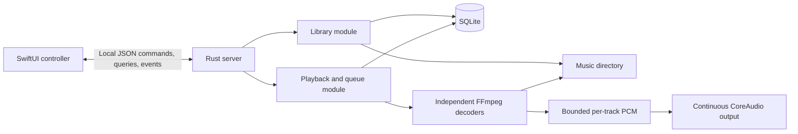

# Initial spike: Rust player server + SwiftUI controller

**Execution status:** the original GStreamer `playbin3`/global-ReplayGain pipeline
failed the audio gate and was replaced by independent FFmpeg decoding feeding a
continuous CoreAudio stream. The native engine, persistent local server,
durable library, and native SwiftUI controller are implemented and exercised;
see [SPIKE_RESULTS.md](SPIKE_RESULTS.md) for commands, evidence, and limitations.
Development LaunchAgent/bootstrap and the 50,000-track/10,000-entry scale experiments are also exercised; results distinguish build profiles, process-cold startup, warm startup, and actual native filtering.
Playback controls include server-owned Next/Previous and toggle, occurrence-bound native seeking, page-independent Now Playing metadata, and macOS system controls. Regular playlists have durable identities/order, bounded native browsing/editing, and atomic enqueue/play. Native multi-row dragging supports insertion points and spring-loaded navigation. Structured live library/playlist filters support title/artist/album predicates, symbolic Boolean operators, grouping and value lists. Smart playlists persist these rules, refresh live membership, and atomically capture full results into the queue or a new regular playlist; dynamic queue autofill remains separate. Server-owned artwork discovery/caching and native album/Now Playing images are implemented and exercised through rescan, browser navigation and offline relaunch. The client remains running after closing its window; explicit Quit pauses daemon audio (resumed on the next launch) and removes its system controls; see `docs/superpowers/specs/2026-10-20-quit-pause-and-player-bar-design.md`. Direct HTTP(S) MP3/Ogg streams support persistent queue occurrences, ICY titles and bounded reconnects. Saved radio stations arrived in protocol v12 and the radio-browser.info station directory in v13. Protocol v13 requires matching client/server processes; the main database is schema 7.

## Development commands

Install Rust, Xcode command-line tools, Python 3.9+, and optionally `just`
(`brew install just`). Server build/test recipes compile pinned FFmpeg and
libopenmpt from source; Homebrew FFmpeg and pkg-config are not required. The first
build needs network access; subsequent builds reuse the verified native cache.

| Command | Action |
| --- | --- |
| `just` | List available recipes. |
| `just build-server` | Build the Rust server and companion CLI tools (debug). |
| `just build-server-release` | Build release Rust binaries against pinned, source-built FFmpeg. |
| `just test-server` | Run all Rust unit and integration tests; hardware tests remain opt-in. |
| `just build-client` | Build the SwiftUI client (debug). |
| `just build-client-release` | Build the SwiftUI client with release optimizations. |
| `just test-client` | Run the Swift client test suite. |
| `just build` | Build both components (debug). |
| `just build-release` | Build both components with release optimizations. |
| `just test` | Test both components. |
| `just dmg` | Build a self-contained release app and package `target/Tyranny.dmg`. |

Server recipes isolate both debug and release artifacts in
`target/portable-rust/{debug,release}` so unrelated FFmpeg headers/libraries cannot
be reused accidentally. Swift uses `target/swift-client/debug` and
`target/swift-client/release`.
The build recipes do not replace `target/Tyranny.app`. Unbundled release Rust
binaries still reference the pinned build cache; use the app/DMG for relocation.

To package the development app, stop the app/daemon before running
`scripts/build_macos.sh`; by default it bundles the pinned release server and
native libraries with a debug client. `scripts/build_macos.sh release` builds both
components in release mode and assembles a self-contained
`target/release/Tyranny.app`. An optional second argument selects the app destination.

### Tracker modules

The scanner accepts `.mod`, `.xm`, `.it`, and `.s3m`, case-insensitively. Rescan
existing music roots to discover these files. Native libopenmpt decoding through
FFmpeg preserves embedded module titles and shows the format as `Tracker`.
No BASS runtime or decoder subprocess is used.
Tracker support integrated at protocol **14**; the current version is **16**.
The version bump follows the merge policy; the wire shape and database schema
are unchanged by tracker support.

Each file is one library item: all subsongs play once, in order. Tracker pattern
and sample loops remain audible, but a song's backward jump does not repeat
forever. Queue repeat remains independent. libopenmpt supplies a brief end fade;
its reported duration and row-aligned seeking are approximate, not sample-exact.
Uncomputable durations remain unknown. These semantics follow the
[libopenmpt API](https://lib.openmpt.org/doc/group__libopenmpt__c.html) and FFmpeg's
[`libopenmpt` demuxer](https://github.com/FFmpeg/FFmpeg/blob/n9.0.2/libavformat/libopenmpt.c).
The pinned minimal build supports ordinary MOD/XM/IT/S3M; compressed containers
and unusual MP3/Vorbis-compressed sample variants are not claimed.

For direct Cargo commands, select the same runtime explicitly:

```sh
prefix="$(python3 scripts/build_ffmpeg.py)"
FFMPEG_DIR="$prefix" MACOSX_DEPLOYMENT_TARGET=14.0 \
  cargo test --locked --target-dir target/portable-rust --test ffmpeg_formats
```

`scripts/make_tracker_fixtures.py --libopenmpt "$prefix/lib/libopenmpt.dylib"`
regenerates the four self-authored module fixtures and measures independent
48 kHz stereo frame references. Full fixture regeneration requires
`TYRANNY_LIBOPENMPT="$prefix/lib/libopenmpt.dylib"` as well as its encoder tools.


### Compilation detection

After upgrading, **rescan existing music roots** in Settings → Library. Metadata
version 3 re-probes unchanged files once to distinguish explicit tags from
fallback display values; SQLite schema 6 and protocol v11 are unchanged.

Albums with different known track artists and no conflicting explicit tags are
grouped as Various Artists when they share an album title and directory, or a
MusicBrainz release ID. `VA` and `Various Artists` album-artist tags are recognized
case-insensitively. Explicit non-VA album artists and explicit compilation flags
win; track artists and media files are never rewritten. Missing album/artist
fallbacks are not evidence of a compilation.

A missing release ID can join a folder/title's single unambiguous tagged release;
the association does not invent a MusicBrainz ID in track metadata. Conflicting
release IDs and unrelated same-title directories stay separate. Additions,
removals and retags reconcile after probing, preserving track IDs and reversing
stale inference. Unavailable roots retain their last-known records. Reconciliation
uses temporary coordinator worklists and 64-track update batches, not playback
thread work. Interrupted scans require the existing manual rescan recovery.

### Audio equalizer

Open **Playback → Equalizer…** (`⌥⌘E`), or **Settings → Playback → Open
Equalizer…**. The parametric editor supports up to 16 independently bypassable
bands: bell, low shelf, high shelf, high-pass, low-pass and notch. Select a band
to edit its numeric controls, or drag its point on the logarithmic response
graph to change frequency and gain. Numeric edits apply on Return; steppers
support incremental keyboard/Accessibility adjustments.

| Parameter | Range / meaning |
|---|---|
| Frequency | 20–20,000 Hz at the 48 kHz engine rate |
| Bell/shelf gain | −24…+24 dB |
| Bell/notch Q | 0.1–18 |
| Pass Q | 0.1–18; scales only the highest-Q section relative to Butterworth Q = 1/√2 |
| Pass slope | 12, 24, 36 or 48 dB/octave |
| Shelf slope S | 0.1–1, RBJ shelf slope |
| Preamp | −96…+12 dB |

Higher-order pass filters use Butterworth section Q values; only the most
resonant section is adjusted. Their Q control is not the total filter bandwidth.
Controls irrelevant to a filter type are hidden, but their retained values
remain validated.

The graph previews the retained curve during global bypass. The combined curve
includes preamp; the selected-band curve does not. Headroom guidance estimates
the maximum combined filter boost over 20 Hz–20 kHz, refining narrow peaks.
**Compensate Preamp** applies the suggested attenuation, bounded at −96 dB;
an excessive-boost warning explains when that cannot compensate the curve.
This is not a transient/inter-sample clipping guarantee. There is no limiter.

Flat, Bass Boost, Treble Boost and Vocal retain their original responses.
Reset removes all bands and restores zero preamp while preserving global bypass.
Named user presets live on the server (up to 64); save overwrites an exact
matching name, rename rejects an existing destination, and delete removes only
the preset. Recall preserves the current global bypass choice. Names contain
1–80 Unicode scalars, without surrounding whitespace or control characters;
identity is byte-exact, not case-folded or Unicode-normalized.

The fixed-capacity stereo biquad bank runs after decoding/ReplayGain and before
the output ring for local files and live streams. A live edit warms an incoming
bank for 10 ms and crossfades for 20 ms. Rapid edits retain only the newest
pending bank; the final configuration settles within 60 ms of processed audio
after the last edit. Coefficients are prepared outside the sample loop. Settled
bypass and flat curves preserve PCM bits; identical updates preserve histories.
History spans natural gapless boundaries and resets on seek, stop, explicit
reselection and stream reconnection.

Edits affect newly processed PCM, not samples already buffered: allow roughly
1.4 seconds plus decoder/device buffering. Pausing does not flush old audio.
Settings are persisted before applying/publishing; invalid input or a failed
write does not change audio/settings. Reconnection fetches authoritative server
state rather than replaying abandoned client edits.

Parametric EQ integrated at protocol **v15**; the current version is **v16**; upgrade client and server together.
The merge bumps the version from 14 because the EQ wire shape changed.
`set_equalizer` takes a complete object, also returned in
`snapshot.settings.equalizer`:

```json
{"id":1,"command":"set_equalizer","equalizer":{"enabled":true,"preamp_db":-6,"bands":[{"enabled":true,"kind":"bell","frequency_hz":1000,"gain_db":6,"q":1,"shelf_slope":1,"slope_db":12}]}}
```

All EQ fields are required; unknown fields and the old `bands_db` wire shape
are rejected. Numeric values, including inactive parameters, must be finite
and within range. Saved graphic settings migrate only when reading storage:
their frequency-specific Q preserves the original one-octave bandwidth
correction, including at 16 kHz. No parallel legacy wire interface remains.

`snapshot.settings.equalizer_presets` contains `{name, equalizer}` objects.
`save_equalizer_preset` takes `name` and `equalizer`;
`rename_equalizer_preset` takes `name` and `new_name`;
`remove_equalizer_preset` takes `name`. These return `Applied` without changing
the active EQ. Use `set_equalizer` to recall a saved curve.

Regression checks: `cargo test --locked equalizer` and
`swift test --package-path macos --scratch-path target/swift-client --filter EqualizerTests`.
Use the repository's pinned FFmpeg prefix for Rust builds (see `justfile`).
The debug client's `--equalizer-smoke-output <directory>` hook exercises native
controls against an explicitly supplied isolated loopback daemon with empty
library/queue. Supply `--url`, `--token-file` and `--ui-driver`; add
`--equalizer-smoke-restore` after restarting that daemon to verify settings and
saved presets. Build the driver from current source:
`swiftc scripts/native_ui_driver.swift -o target/native-ui-driver`.

### Client command language

`TyrannyCore.CommandLanguage` defines the client-only grammar, command registry,
argument validation, completion, and snapshot-relative transport resolution.
The Rust protocol still accepts structured commands, not command strings.
The macOS `CommandDispatcher` maps commands to the existing playback, activation,
playlist, queue, navigation, and selection models. It uses the window's
`TrackLists`, not a second selection store.

The library window installs `NavigationModel.submitCommand(_:) async throws`
and `completeCommand(_:)`. These are the entry points for future keybindings and
command-mode UI. **There is no interactive command bar or configurable keybinding
UI yet.** Existing menus and controls continue calling their typed models.

Grammar: optional leading `:`, a case-sensitive command name, then
whitespace-separated arguments. Single/double quotes group a literal argument;
backslash escapes the next character, including inside quotes. Quoted and
unquoted pieces may form one argument. No shell execution, expansion, pipelines,
or command chaining. Unknown commands, missing/extra arguments, invalid enum
values, unterminated quotes, and trailing escapes are errors. Names/rules cannot
be blank; `filter ""` clears the filter.

Examples:

```text
:seek +1m
seek -10s
seek 50%
volume +5%
playlist-open "Night Mix"
playlist-rename "Night Mix" "Evening 日本語"
smart-create Jazz "genre:Jazz"
```

Seek values are decimal seconds (default), `s`, `m`, `h`, or `%` of the current
track duration. A leading `+`/`-` makes the value relative to the authoritative
position. Seeking requires a current occurrence, known positive duration and
sample rate; the request retains its entry ID so a track change cannot redirect
it. Results are floored to whole frames and clamped to `0...duration_frames-1`.
Overflow/nonfinite values are rejected. Volume uses absolute or signed-relative
percentage points, clamped to `0...100` and rounded to whole percentages.

| Action family | Commands |
| --- | --- |
| Playback | `play`, `pause`, `toggle`, `stop`, `next`, `previous`, `seek`, `volume`, `repeat off\|all\|one\|cycle`, `shuffle on\|off\|toggle`, `gain off\|track\|album`, `resume on\|off\|toggle` |
| Navigation | `go songs\|albums\|artists\|genres\|recent\|history\|up-next\|radio`, `filter`, `focus-filter`, `reveal-playing`, `settings connection\|library\|playback`, `quit` |
| Connection/library | `connect`, `disconnect`, `server start\|restart\|stop`, `choose-folder`, `rescan <root-id>`, `retry-import`, `browse-library` |
| Playlists | `playlist-open`, `playlist-create`, `playlist-rename`, `playlist-delete`, `playlist-play`, `playlist-enqueue`, `playlist-add`, `smart-create`, `smart-update`, `smart-snapshot` |
| Queue/selection | `queue-clear`, `queue-shuffle`, `queue-save`, `selection-play`, `selection-run`, `selection-next`, `selection-enqueue`, `selection-remove`, `selection-move <entry-id\|end>`, `selection-album`, `selection-artist`, `selection-all`, `selection-clear` |
| View preferences | `browser`, `drawer`, `artwork` (`on\|off\|toggle`); `group none\|album\|artist_album`; `sort <field> [asc\|desc]` or `sort none`; `column <column-id> on\|off\|toggle`; `album-sort album_artist\|year\|date_added`; `cover-size 96...200`; `album-expand`, `album-collapse`; `browser-genre`, `browser-artist`, `browser-album` (`<id\|all>`) |
| Activation/help | `up-next-policy ask\|keep\|replace`, `prompt keep\|clear\|cancel`, `help [command]` |

`help` uses the registry's usage/summary metadata. Playlist commands resolve exact
names against the paged server catalog; missing or ambiguous names are errors.
Rename/snapshot take a second name, smart create/update take a rule, and
`playlist-add` uses the current selection. Selection commands follow the current
view; operations unavailable there fail explicitly. `selection-run` plays a run
from a single selected row; `selection-play` plays the selected rows.
Queue clear/shuffle/save act on **upcoming** entries, preserving the current track.
Playlist reorder requires an ungrouped, unsorted regular playlist.

Mutations await their server reply and propagate failure through the normal busy
gate. Playback state changes may arrive later. Commands that need an Up Next
decision open the existing prompt rather than bypassing Ask/Keep/Replace; use
`prompt` or the sheet to resolve it. A rescan reply accepts asynchronous indexing;
it does not mean indexing is finished.

`CommandLanguage.completions(_:playlistNames:)` completes at the **end** of the
supplied text and returns whole replacement lines. It completes command names,
enumerated arguments, and playlist names, including partially quoted names;
insertions are escaped and preserve the optional colon. Free text/numeric
arguments are described by registry metadata rather than invented suggestions.
The app adapter requests the existing playlist catalog windows; suggestions
reflect the catalog currently loaded and can be requested again as it arrives.

Verification:

```sh
just test-client
python3 scripts/client_gate.py --commands-only \
  --app target/swift-client/debug/Tyranny --work-dir target/command-gate
```

The command gate uses an isolated real Rust server and three generated audio
tracks. It checks ordered selection enqueue, absolute/relative/percentage seeks,
volume/modes, quoted playlist operations and completion, smart snapshots, local
navigation preferences, and rejected invalid/disconnected commands. It is
dispatch verification, not UI-input, screenshot, or acoustic-output proof.

Verified on 2026-10-20: 270 Swift tests in 39 suites; all six command-gate
scenarios; and all six native `--scenario runs` scenarios, including the
Ask/Keep/Replace prompts and adding 1,129 selected tracks in one playlist
revision. The Accessibility driver now searches modal sheets before the
underlying library row tree; the previous traversal stalled at the playlist
picker in this large-selection run. Passing reports:
`target/command-gate/run-gs_2x3bj/commands.json` and
`target/command-ui-modal/run-mxy6r54o/runs/report.json`.

### Lyrics

The player-bar **Lyrics** button (**⌥⌘L**) opens a pane for the current queue
occurrence. Embedded `USLT`/`LYRICS` tags take precedence. Without embedded
lyrics, the server requests an exact title/artist/album/duration match from
[LRCLIB](https://lrclib.net/docs); it never falls back to fuzzy search or uses
radio station titles as song metadata. The pane distinguishes loading, missing,
unavailable and instrumental results, displays plain lyrics or highlights LRC
lines using the server playhead, and credits the provider with a record link.
Pausing and seeking retain the authoritative position rather than extrapolating
a separate lyrics clock.

Only an open, mounted pane creates lyrics demand. A separate client connection
and two bounded server workers keep file probing and HTTPS requests off playback
controls. Track, library revision, connection and completed-scan changes
invalidate client results. Closing the pane cancels its request.

The additive protocol-v10 request is
`{"id":1,"command":"lyrics","entry_id":7,"library_revision":2}`; its result has
`kind:"lyrics"` and a `lyrics` payload. Queue IDs and library revisions are
validated before and after discovery; clients cannot supply paths or provider
URLs. The main database schema stays unchanged.

The private `state.lyrics.sqlite` cache is disposable: up to 16 MiB of payload
and 2,048 records. Online successes survive restart/rescan until eviction;
misses expire after 24 hours and transient failures after 60 seconds. Embedded
discovery uses file fingerprints and scan watermarks; remote results use track
metadata, so an unrelated scan does not discard offline lyrics. Requests are
sequential with a 500 ms delay and honor provider backoff. No credentials or
additional provider scrapers are configured. See the cited
[provider assessment](docs/lyrics-providers.md) for access and licensing limits.

### Release disk image

Run `just dmg` or `scripts/build_dmg.sh` to build the release client and server,
assemble and ad-hoc sign a fresh app bundle, and create a compressed
`target/Tyranny.dmg`. The image contains `Tyranny.app` (including its server,
FFmpeg libraries, icon, and source/license artifacts) and an Applications
shortcut. Drag the app to Applications before launching it; do not run the
managed server from the mounted image.

The source builder currently supports native **arm64 macOS**, with a deployment
target of macOS 14. It downloads [FFmpeg 9.0.2](https://ffmpeg.org/releases/ffmpeg-9.0.2.tar.gz)
and verifies the pinned SHA256 before extraction. The FFmpeg pin was established
by verifying its upstream detached signature against the published signing
fingerprint. It also verifies pinned official release archives for
[libopenmpt 0.8.9](https://lib.openmpt.org/files/libopenmpt/src/libopenmpt-0.8.9+release.autotools.tar.gz)
and build-only [pkgconf 3.0.10](https://distfiles.ariadne.space/pkgconf/pkgconf-3.0.10.tar.gz).
The first build needs network access; subsequent builds reuse a checksum-verified
cache under `target/native`, keyed by dependency sources/options, architecture,
builder, compiler, and SDK. Interrupted installs are not reused.
FFmpeg's build system requires a checkout/toolchain path without whitespace or
shell/make metacharacters; the builder rejects these paths early. The packaged
app itself supports spaces and Unicode in its installation path.

The controlled configuration retains native decoders/demuxers and embedded image
support, builds shared avcodec/avformat/avutil/swresample, and disables GPL,
nonfree, version-3-only code, external-library autodetection, encoders, muxers,
devices, filters, and hardware acceleration. It uses macOS system zlib, bzlib,
iconv and Secure Transport. The only enabled protocols are file, HTTP, HTTPS,
TCP and TLS; stream entries use verified HTTPS and an MP3/Ogg demuxer whitelist,
while local playback keeps its file-only protocol whitelist. libopenmpt is the
only external decoder engine; its optional external codec/output dependencies
are disabled, and its C++ runtime is Apple's system libc++.

Packaging copies the five dylibs to `Contents/Frameworks`, rewrites their
transitive dependencies and install IDs to `@loader_path`, and removes runpaths.
Unresolved libraries, non-system dependencies outside the pinned prefix,
unapproved libraries, symlink escapes, and basename collisions fail packaging.
`Contents/Resources/native-dependencies.json` records the closed, bundle-relative
dependency graph. Libraries are signed after relocation, followed by the helper
and app. Temporary staging leaves the development app untouched; an existing
DMG is replaced only after the new image passes checksum verification.

This software uses libraries from the FFmpeg project under LGPL-2.1-or-later.
`Contents/Resources/FFmpeg` includes the exact source archive, license texts,
configuration headers, and `build-info.json` with source checksum, configure
arguments, and toolchain provenance. The standard About panel's `Credits.rtf`
points to those resources. Keep these artifacts when distributing the app and
include FFmpeg attribution/source access on any download page; see
[FFmpeg's compliance checklist](https://ffmpeg.org/legal.html).
`FFmpeg/dependencies/libopenmpt` also includes the exact source archive and
BSD-3-Clause/BSL-1.0 notices; `dependencies/pkgconf` records its build-only ISC
dependency. pkgconf is not bundled as a runtime executable.
Dynamic linking and source inclusion are not a blanket codec-patent or legal clearance.

The DMG no longer needs Homebrew at runtime. It is still **ad-hoc signed, not
Developer ID signed or notarized**, and is not a universal binary. Gatekeeper
may block downloaded copies.

Verification on 2026-10-20:

- `just dmg`: built the source libraries, release binaries, and verified DMG;
  a second source-builder invocation reused the verified cache.
- `python3 -m unittest discover -s scripts -p test_macos_dependencies.py`:
  six real Mach-O fixture tests passed, including transitive relocation after
  removing the source libraries and rejection of invalid dependency graphs.
- Rust tests against the pinned prefix (`FFMPEG_DIR=<prefix>
  MACOSX_DEPLOYMENT_TARGET=14.0 cargo test --locked --release --all-targets
  --target-dir target/portable-rust`): 223 passed; one hardware test ignored.
- Copied the signed app out of the mounted DMG to a path containing spaces and
  Unicode, then unmounted the image. With sandbox reads denied for `/opt/homebrew`,
  `/usr/local`, and the entire repository, the helper imported 12 fixtures and
  preserved Unicode metadata. FLAC, MP3, Vorbis, Opus, AAC, ALAC, WavPack, and WMA
  playback passed; two FLAC tracks produced exactly 48,000 stereo frames with
  bit-exact samples and no gap, overlap, or underruns. ReplayGain and paused
  seeking passed.
- The relocated release client rendered the imported library and connected over
  protocol v9 under the same sandbox. The RTF attribution parsed successfully;
  opening About automatically was blocked by Apple Events permissions.
- Local evidence: `target/portable-release-verification/report.json` and
  `release-client.png`. This was a sandboxed same-host check, **not** a clean-Mac,
  macOS 14, notarization, or acoustic-output test.

## Goal and scope

Prove one complete local workflow: launch the app, choose a music directory, see scan progress, browse an artist/album/track library, queue music, and hear continuous playback. Close and reopen the client without interrupting playback or losing authoritative state.

This is a macOS-first architectural spike, not a commitment to drop anything in [REQUIREMENTS.md](REQUIREMENTS.md). The full format/output/provider lists remain product requirements; the spike proves a representative subset and records unsupported capabilities explicitly.

**Deployment decision:** the server reads files and plays through the audio device on the server's machine. Initially both processes run on the same Mac, as the same user. A future remote controller would still control those speakers; streaming audio to the controller is a different feature. Follow MPD's ownership model, not necessarily its wire protocol.

## What the reference implementations teach us

Five parallel read-only scans covered all sibling reference repositories. These are implementation observations, not runtime validation of those apps.

| Reference | Evidence and lesson | Decision for tyranny |
| --- | --- | --- |
| MPD | Server partitions own queue/player/outputs; queue entries have their own IDs and change versions. `idle` signals changes rather than providing durable event replay. [Partition](../mpd/src/Partition.hxx), [queue IDs](../mpd/src/queue/Queue.hxx#L37-L74), [idle](../mpd/src/client/Idle.cxx) | Server authority; stable queue-entry IDs; explicit reconnect snapshots. Do not reproduce partitions, plugin infrastructure, or MPD compatibility in the spike. |
| Resonance | Rust wraps GStreamer `playbin3`; its EOS handler stops playback before notifying the queue. Import embeds Python and Mutagen; models depend on GTK/GLib. [backend](../resonance/src/player/gst_backend.rs#L53-L110), [EOS](../resonance/src/player/gst_backend.rs#L332-L335), [importer](../resonance/src/importer.rs) | Rust/GStreamer is a concrete starting point, but this implementation is not evidence of gapless playback. Keep plain Rust models; do not inherit GTK or embedded Python. |
| Strawberry | Non-crossfade playback prepares the next URL on the existing pipeline. Album queries distinguish album artist from track artist; CUE identity includes URL, segment start, and sheet. [preload](../strawberry/src/engine/gstengine.cpp#L193-L209), [album query](../strawberry/src/collection/collectionbackend.cpp#L1100-L1108), [CUE index](../strawberry/data/schema/schema-29.sql#L3) | Test transitions before building the UI. Separate file, track, and queue-entry identity. Preserve compilation metadata from the first import. |
| cmus | Queue entries can be appended/prepended independently; playback has buffering and gain logic separate from presentation. Filters and cursor search are distinct. [queue](../cmus/play_queue.c#L41-L67), [player](../cmus/player.c), [filters](../cmus/filters.c), [search](../cmus/search.c) | Separate queue from saved playlists. Use explicit commands that future buttons, keybindings, and command mode can share. Do not import the command-language grammar yet. |
| Feishin | Ordinary MPV playback is client-side; Jukebox is a separate server-playback path. Large lists use paged caches keyed by server/query. [MPV engine](../feishin/src/renderer/features/player/audio-player/engine/mpv-player-engine.tsx), [Jukebox engine](../feishin/src/renderer/features/player/audio-player/engine/jukebox-player-engine.tsx), [list loader](../feishin/src/renderer/components/item-list/helpers/item-list-infinite-loader.ts#L37-L100) | Borrow bounded loading, not renderer-owned playback state or multiple-engine reconciliation. SwiftUI must not maintain a second authoritative queue. |

Use these repositories as design references, not source to transplant. They contain GPL-licensed code; review licensing before any reuse, and separately review the selected multimedia binaries/plugins before distribution.

## Proposed architecture



Keep one Rust package with internal modules initially, plus a separate native macOS app target. No microservices, public plugin system, shared database access, or speculative backend traits.

- **Library module:** owns roots, asynchronous indexing, metadata, album grouping, bounded queries, and scan progress. SQLite with migrations, transactional batches, and indexes; no full import on startup.
- **Playback module:** owns queue order, current entry, transport state, next-item preparation, gain, and resume policy. Serialize commands through one owner. Native decoding and filesystem access stay on that worker; the continuous output callback consumes only preallocated PCM. SwiftUI, database work, and network requests must not block the audio callback.
- **Artwork module:** two bounded workers own embedded/folder discovery, release-ID-only Cover Art Archive retrieval, image normalization and a disposable persistent cache. Separate artwork connections prevent slow image requests from queuing ahead of main transport controls.
- **Protocol module:** exposes commands, queries, and authoritative state without leaking FFmpeg types or SQLite rows. The implemented server uses Tokio, tungstenite, Serde, and rusqlite; the audio engine uses ffmpeg-next, a native CoreAudio DefaultOutput AudioUnit, and bounded SPSC rings.
- **SwiftUI client:** owns navigation, selection, view caches, and connection presentation. Uses native tables/split views and a folder picker. Does not decode audio, scan the directory, or decide which track plays next.

### Small initial interface

Use versioned JSON over loopback WebSockets, accessible from Swift through `URLSessionWebSocketTask`. Use request IDs for replies and typed events. The native client keeps its main control connection separate from two reusable artwork connections; no MPD compatibility layer or Rust/Swift FFI.

- Library: add root, request rescan, observe scan status, and list album artists/albums/tracks with one shared structured track filter and bounded pages.
- Artwork: request a bounded thumbnail/display image for an authoritative album or durable queue occurrence at a library revision. The client cannot supply an image path or provider URL.
- Saved playlists: create, rename, delete, insert indexed tracks before an occurrence or at the end, atomically remove/reorder occurrence batches, read bounded pages, and append a whole playlist to the queue with optional immediate playback. The library's Add to Playlist picker can create and populate a new destination directly. Playlist editing never edits already-enqueued occurrences.
- Smart playlists: save/edit a named library filter, preview and browse bounded live results, and atomically create a regular snapshot of every matching track. Rules evaluate over the entire available library, independently of selected artist/album panes and temporary entry filters. The Add to Playlist picker lists regular destinations only.
- Queue: append, atomically insert indexed track batches or move occurrence batches, remove, clear, and read a page. Commands address queue-entry IDs, not row indexes or track IDs. Native dragging captures source IDs/revisions; cross-page drops use revision-bound insertion anchors.
- Transport: play a queue entry, pause, stop, next, previous, seek, volume, and ReplayGain mode.
- State: current entry, actual transport state, position/duration, queue/library/playlist revisions, scan state, and actionable errors.

At connection, send a protocol version, a fresh server-instance ID, and an authoritative control-state snapshot, followed by ordered events. Capture snapshot and event subscription in the same serialized operation so changes cannot fall between them. Queue/library/playlist pages carry revisions; reject stale mutations and restart stale page reads rather than merge inconsistent data. Reconnect always refreshes state; no durable event log in the spike. Do not automatically replay a non-idempotent command after an uncertain disconnect.

Position updates are low-rate observations; the UI may interpolate between them using a local monotonic clock, then correct on seek/pause/track change. A successful command receipt is not proof audio has started: engine events determine actual playback state.

Bind only to loopback, authenticate using a per-user token stored with restrictive permissions, and reject unexpected browser origins. Do not open a LAN listener as part of this spike.

### Saved radio stations

Protocol v12 adds a server-owned catalog of saved internet-radio stations. It has its own `stations_revision`, published in every `ControlState`.

- Commands: `stations` (replies `stations` with `revision` and `stations`), `add_stations`, `update_station` and `remove_station`. Each edit carries `expected_revision` and replies `stations_applied` with the new snapshot and the added or updated rows. A stale revision fails with `stale_stations_revision`.
- `add_stations` takes `stations: [{name, url}]`. A blank name becomes the URL's host. Every entry passes `StreamSpec::new`, the same check as `append_stream`. If one entry is invalid, the whole command fails with `invalid_command` and the message names its 0-based index. Nothing is saved. The macOS import reports it as the 1-based station in the file.
- Stations are unique by canonical URL. Adding a URL that is already saved is skipped. Updating a station to a URL another station uses is `invalid_command`.
- The catalog is sorted by name without regard to case, then by ID.
- Limits: at most 1000 stations, and 1..=500 per `add_stations`.
- Queue entries are independent. Appending a station copies its URL and title into the queue entry. Later station edits and removals never change a queued entry.

### Identity and persistence invariants

- A **media asset** locates a file; a **track** is a playable item, potentially a segment of that file; a **queue entry** is one occurrence of a track. Repeated tracks in a queue have different entry IDs. CUE parsing is deferred, not made impossible by using paths as track IDs.
- Preserve title, track artist, album artist, album title, disc/track numbers, compilation flag, duration, and available gain/peak and MusicBrainz IDs. Store Unicode metadata without destructive normalization; keep filesystem locations separate from display/search strings.
- Group albums by release ID when available; otherwise use album artist/title and source-directory context, not title alone. Compilation tracks keep their individual artists without splitting the album. Sophisticated cross-directory release reconciliation is deferred.
- Queue entries survive removal/reordering of other entries. Removing the current entry stops playback in the spike; removing/moving a prepared next entry must invalidate that preparation. End of queue stops; no implicit fallback to the library.
- Regular playlists have independent stable identities and occurrence IDs, including duplicates. Smart playlists have stable playlist identities and persisted rules; their read-only result IDs are library track IDs, not stored occurrence IDs. Catalog and individual revisions protect edits; entry pages also bind library revision. Names are unique under Unicode lowercase matching. Missing indexed sources remain visible in regular playlists but leave smart membership; loading an unavailable regular playlist fails without a partial queue edit.
- Persist roots, indexed metadata, regular playlist order/occurrences, smart rules, queue order/current entry, settings, and position checkpoints. Acknowledge durable edits after commit. Restore stopped/paused by default; automatic playback is explicit opt-in. Checkpoint position periodically and on pause/clean shutdown; document bounded position loss after a crash.

## Build order and acceptance gates

### 1. Prove the audio path before committing to it

The first candidate used GStreamer `playbin3`, `osxaudiosink`, and global `rgvolume`. It failed trim, transition, gain-fallback, and mixed-rate checks. The rejected measurements were recorded in `spike-results/audio-gate.json` (generated reports are now ignored and have been removed from Git history); that backend is no longer part of the executable. Written findings remain in [SPIKE_RESULTS.md](SPIKE_RESULTS.md).

The replacement uses a fresh native FFmpeg demuxer/decoder/resampler per track, applies gain before buffering, and feeds one CoreAudio DefaultOutput AudioUnit with 48 kHz stereo client PCM. CoreAudio converts to the device's native format without changing its nominal clock; the original CPAL output adapter incorrectly required 48 kHz hardware and has been removed. Queue-occurrence tokens invalidate prepared PCM. The fixture suite covers FLAC, two MP3 encoder variants, libvorbis, Opus, WAV, and AAC-in-MP4; these tested formats do not establish the complete FFmpeg/libmodplug/BASS requirement.

**Gate:** a headless Rust executable plays actual audio, seeks/pauses, advances tracks without the UI, and applies track/album gain correctly. Use adjacent fixtures split from a continuous signal and capture PCM at the output seam to check missing/duplicated frames, including encoder delay/padding in lossy fixtures. Also listen through CoreAudio; an internal PCM capture alone does not prove the device path. Report same-rate gapless results separately from mixed-rate/channel transitions. Exercise a short track, corrupt next track, and queue edit during preparation; an unplayable next entry must produce a visible error, not hang or loop.

Use a fixed output rate with resampling for this first engine; bit-perfect output and automatic hardware-rate switching are not spike claims. If measured transitions or macOS deployment fail, stop and revisit the engine before adding product surface. The executable links FFmpeg directly, not through a decoder subprocess or MPD wrapper. Passing automated captures and device execution still does not replace the listening gate.

### 2. Establish server authority and reconnect behavior

Add the command owner, queue-entry IDs, protocol, and SQLite-backed queue/settings. Drive it with a small development client before SwiftUI.

**Gate:** two connections see the same current entry and queue. Append the same track twice, reorder entries, disconnect one controller, and reconnect it during playback. It receives current state, not stale local history. Restart the server: the queue survives and optional resume follows the chosen policy. A rescan or slow controller must not stall audio. Keep regression coverage for duplicate identity, stale edits, and next-item transition races.

**Executed:** the real server passed two-controller, stale-edit/page, disconnect/reconnect, slow-client, crash-restart, paused-default, and opt-in-resume checks through both clock-paced capture and CoreAudio. Persistent queue/settings and the development controller are implemented. The library gate also exercises import during playback; the complete application workflow is not yet claimed.

### 3. Build folder onboarding and a durable library

Walk one selected directory in a bounded background worker; use native FFmpeg metadata extraction to reuse the selected multimedia runtime. Import in batches, expose discovery/indexing phases and failure counts, and retain usable records when another file is unreadable. Once enumeration is complete, show determinate processed/total progress rather than a fabricated percentage.

Manual rescan is enough initially: compare per-file size/mtime, update changed records, and reconcile missing files only after a successful scan. A temporarily unavailable root must not erase the collection. Do not rely on directory mtime alone to detect edited tags. Full filesystem watching and robust move detection come later.

**Gate:** import a real collection containing Unicode paths, missing tags, a compilation, multiple discs, duplicate album titles, and an unreadable/corrupt file. Reopen the server and browse the index without a rescan. Add/change/remove files and rescan without duplicating unchanged tracks. Metadata-only scale fixtures may exercise queries, but do not substitute them for a real audio import.

**Executed:** the native scanner and dedicated SQLite coordinator import generated real FLAC/WAV files, expose bounded revision-consistent queries, and enqueue indexed tracks through the playback owner. The process gate covers 2,056 imported tracks, metadata/grouping, unchanged and changed rescans, unavailable roots, incomplete traversal, corrupt-file retries, restart without rescan, interrupted-scan recovery, and playback during import. Missing entries become unavailable only after a complete scan; their identities remain durable. Native folder selection is exercised in phase 4; phase 5 separately measures a 50,000-track metadata-only index, not a real 50,000-file import.

### 4. Build the native three-pane controller

Use a concrete first interpretation of the requirements: **album artists | albums | tracks**, with a persistent transport strip and a separate queue view. Add a prominent “Choose Music Folder” empty-state action, scan progress, live text filtering, multi-selection, and enqueue/play actions. Keep native appearance; artwork-provider integration and custom theming are not prerequisites.

Request bounded pages for both library and queue. Preserve selection by ID across refreshes. Build explicit disconnected, connecting, scanning, empty, ready, and error presentations rather than treating an empty list as every state.

**Gate:** complete the choose-folder-to-play workflow through the actual SwiftUI surface. Close and reopen the client while the daemon keeps playing. Seek, pause, enqueue a selection, and change the queue without duplicate commands or stale highlighting. Filtering/browsing must remain responsive while scanning and playing.

**Executed:** the ad-hoc-signed development `Tyranny.app` completes the actual native picker-to-play workflow against the Rust server in clock-paced and CoreAudio modes. Native controls exercise three-pane selection, bounded page replacement, multiselection playback, pause/seek/resume, queue reorder/removal, filtering during an active rescan, persisted resume settings, disconnect/reconnect, and quit/relaunch without interrupting server playback. The fixture grows from 105 to 1,129 real audio paths; the UI keeps 100-row pages. Composited screenshots and separate Swift transport/model regressions are retained with the results. This proves the controller surface, not managed daemon startup, human listening, or production-scale latency.

### 5. Prove the macOS process and scale assumptions

Run the server independently as a per-user process; use a development LaunchAgent to establish its lifetime and an app connection/bootstrap path. Closing a window or quitting the controller must not kill it. Defer a polished installer, not the independent-process proof.

Use an explicitly **non-sandboxed development build** for the spike. The daemon must itself verify access to the selected root and retain access after restart; a folder selected by the GUI is not proof that another process can read it. TCC and ordinary filesystem restrictions still apply. If sandboxed distribution is required later, prove bookmark transfer, persistent access, and helper lifecycle separately. Apple's [file-access documentation](https://developer.apple.com/documentation/security/accessing-files-from-the-macos-app-sandbox.md) distinguishes persistent security-scoped bookmarks from interprocess bookmark grants; passing a path string is not a sandbox permission transfer.

**Gate:** exercise app launch with daemon absent/present, client quit/relaunch, server restart, unavailable root, and missing native decoder library. Record required runtime libraries and run the packaged development app outside the build shell so accidental environment dependencies are visible.

Proposed performance targets, not measured promises: with an existing index of 50,000 tracks and a 10,000-entry queue, first usable library page within 1 second of warm client launch; common paged filter queries below 100 ms p95 on the development Mac. Measure end-to-end UI latency as well as query time, record cold startup separately, and verify that the UI does not hydrate the entire collection. Audio must remain uninterrupted during scanning and filtering.

**Executed:** the real development app bootstraps an independent per-user LaunchAgent, reuses authenticated existing servers, and exposes explicit start/restart/removal controls. LaunchServices runs cover client quit/relaunch, clean/crash recovery, unavailable and permission-denied folders, durable state, manual-owner protection, and actual dyld failure from a missing decoder dependency. The bundle includes a release Rust helper and a transitive native-library inventory, but still depends on Homebrew.

The reproducible scale gate seeds a declared metadata-only 50,000-track index and 10,000 real-media queue occurrences. It measures authenticated query distributions, process-cold and warm native startup, bounded 100-row client pages, real Accessibility-driven filtering, and real WAV scanning during playback. Performance-target verdicts remain separate from functional results; missing scan/filter overlap fails the full native gate. See the result document for measured timings, build profiles, screenshots, and remaining distribution/listening limits.

## Explicitly deferred from this spike

- Remaining codecs/containers, audio CD, module/BASS support, and every non-CoreAudio output. Maintain a tested capability list; broad dependency support is not a coverage claim.
- The radio directory lookup; dynamic queue autofill; the directory-browser screen. Direct SHOUTcast/Icecast MP3/Ogg playback is implemented; see [streaming evidence](SPIKE_RESULTS.md#http-stream-playback).
- MusicBrainz tag retrieval, additional cover providers and artist/title matching, lyrics providers, scrobbling, and tag writing. Artwork fallback uses an existing MusicBrainz release ID only; it does not search for or rewrite tags.
- Audio analyzer, artwork-derived colors, configurable themes, external commands, Vi search/command modes, and keybinding configuration.
- CUE ingestion and sophisticated release reconciliation; preserve the identity seams now.
- MPRIS remains a later Linux integration; macOS media keys/Now Playing route the same Rust commands without a second player. Native track notifications are implemented; authorized banner/artwork delivery verification awaits macOS permission (see [SPIKE_RESULTS.md](SPIKE_RESULTS.md)).
- Remote networking, multiple users/zones, MPD wire compatibility, client-local streaming, App Store sandboxing, and a production installer.

These are sequencing decisions for an initial spike, not deletions from REQUIREMENTS.md.

## Exit decision and evidence to retain

The spike succeeds when the native workflow, independent server lifetime, measured audio transitions, reconnect/resume behavior, and bounded library/queue access all work together. Retain the measured format/gapless matrix, gain results, scale timings, launch instructions, and remaining packaging constraints. A UI playing one file is not sufficient evidence.

Proceed with the native FFmpeg/CoreAudio engine only on the strength of its measured behavior and deployment checks. Keep the rejected GStreamer evidence distinct from the replacement's results.

### Research-time environment observations

At initial planning time the repository had an empty dependency list and a `Hello, world!` entry point. Rust/Cargo 1.99.1, Swift 6.3.3, and an Xcode developer directory were detected. `ffmpeg`, `mpd`, and `pkg-config` were on PATH; GStreamer was not installed. Subsequent experiments installed GStreamer, FFmpeg development libraries, and LAME. Current executables are `audio-probe`, `tyranny-server`, `tyrannyctl`, and the native `Tyranny.app` controller; the hello-world entrypoint and GStreamer Rust dependencies have been removed. See the result document for current build instructions rather than treating these historical observations as prerequisites.
